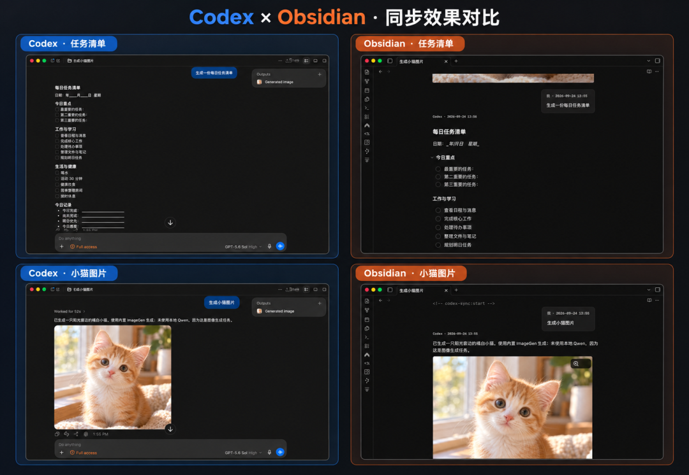

# Codex Daybook

[](https://obsidian.md/plugins?id=codex-daily-sync)
[](https://github.com/isink/Codex-Daybook/releases/latest)
[](LICENSE)


**Turn your local AI conversations into Obsidian notes, automatically.** Every Codex Desktop task and every WorkBuddy conversation becomes a searchable, linkable Markdown note that stays in your vault.



[Quick start](#quick-start) · [What a note looks like](#what-a-note-looks-like) · [WorkBuddy](#workbuddy-conversations-experimental) · [FAQ](#faq) · [中文说明](README.md) · [Privacy](PRIVACY.md) · [Changelog](CHANGELOG.md)

---

## Why

Plans, debugging conclusions and drafts you work out with an AI get buried under the next conversation. Codex Daybook quietly files them into your knowledge base:

- **Automatic archive**: one note per task, updated incrementally as new replies arrive. No copy and paste.
- **Only what matters**: your questions, final answers and formal plans. Reasoning, tool calls, system messages and unfinished turns are left out.
- **Images included**: local images from the conversation are copied into your attachments folder, deduplicated by content, and shown inline.
- **Your notes are safe**: sync only touches the managed region of each note. Text and properties you add outside it are kept.
- **Daily notes**: optionally link each task into a Dataview daily track by its creation date.
- **Fully local**: the plugin itself sends no network requests, uploads nothing and collects no telemetry.

## Quick start

**Requires** Obsidian 1.13.7+ (desktop only) and a local Codex Desktop installation. [Dataview](https://obsidian.md/plugins?id=dataview) is only needed for the optional daily track.

1. In Obsidian, open **Settings → Community plugins → Browse**, search for **Codex Daybook**, then install and enable it.
2. In the plugin settings, pick the **Notes folder** and **Attachments folder** under **Basic settings**. The Codex executable is detected automatically.
3. Turn on **Allow access outside the vault**, click **Sign in to Codex** to finish the ChatGPT sign-in in your browser, then click **Check connection**.
4. Once the check passes, click **Start sync**. Codex tasks created from now on become notes automatically.

> **Only tasks created after you click Start sync are saved.** This is deliberate, so hundreds of old conversations don't flood your vault. The connection check needs at least one existing task; if you have none, finish a quick one in Codex first.

<details>
<summary>Manual install / Windows notes</summary>

- **Manual install**: download `codex-daily-sync-<version>.zip` from the [latest release](https://github.com/isink/Codex-Daybook/releases/latest), put the `codex-daily-sync` folder into your vault's `.obsidian/plugins/`, then enable it under Community plugins.
- **Windows**: Codex Desktop from the Microsoft Store does not let other programs start its bundled Codex. Install the CLI as well: `npm install -g @openai/codex`. It reads the same conversation data as the desktop app.
- **Detection fails**: scan for or choose the Codex executable in settings. Only choose a program you trust; it runs with your permissions.

</details>

## What a note looks like

Each note carries properties (handy for Dataview) and a question-and-answer transcript in callouts:

```markdown
---
title: Add a chart to the weekly report
type: codex-conversation
created_at: 2026-11-06T10:46:53+08:00
daily: "[[Daily/2026-11-06]]"
---

<!-- codex-sync:start -->
> [!codex-question] Me · 2026-11-06 10:46
> Can the weekly report script also draw a bar chart of this week's commits?

> [!codex-answer] Codex · 2026-11-06 10:49

Sure. I added `plot_commits()` to `report.py`…
<!-- codex-sync:end -->

Anything below is your own; sync never touches it.
```

## What gets synced

| Saved to your note | Never saved |
|---|---|
| Your questions | Reasoning |
| Final answers and formal plans | Tool calls and command output |
| Local images (PNG / JPEG / GIF / WebP) | System messages, internal context |
| Title, creation time and other properties | In-progress or failed turns, remote images |

- Each task keeps its own folder, time zone and creation day; changing settings later doesn't move old notes.
- Unchanged conversations are not rewritten.
- Deleting or archiving a source conversation does **not** delete local notes, images or daily links.

## WorkBuddy conversations (experimental)

Save your local WorkBuddy conversations as notes too. It runs independently of Codex sync and is off by default.

1. Open the **WorkBuddy** tab in the plugin settings and click **Scan WorkBuddy data**. The plugin finds the data folder and fills it in.
2. Click **Check local data** to confirm completed conversations can be read.
3. Click **Start WorkBuddy sync**. Existing local conversations are imported once, then new replies are picked up automatically.

There is no separate permission toggle: clicking these three buttons is what allows the plugin to read your local WorkBuddy data, read-only. If the scan finds nothing, enter the absolute path of the data folder yourself.

- **Where things go**: notes in `WorkBuddy Conversations/`, images from your questions in `Attachments/WorkBuddy/<note>/`. Both can be changed in settings.
- **What it reads**: only `~/.workbuddy/projects` and a few common data locations. It never crawls the whole disk.
- **Account and network**: no WorkBuddy token and no WorkBuddy cloud API.
- **Verified on**: WorkBuddy 5.6.2 and 5.7.7 for macOS. Cloud-only tasks are not supported.

> WorkBuddy's local file format has no official stability promise. If a conversation can't be read, only that conversation stops importing; existing notes stay as they are.

## Privacy

- Sign-in uses Codex's official browser flow. The plugin **never sees your password or tokens**.
- The plugin sends no HTTP requests, uploads no conversations, collects no telemetry and installs no dependencies.
- Codex itself may contact OpenAI according to its own configuration; whether your vault is uploaded depends on your own sync tools.
- The plugin's `data.json` contains task IDs and note paths. Treat it as personal data.

Full details: [PRIVACY.md](PRIVACY.md).

## FAQ

**Can it import my ChatGPT web history?**

No. It handles local Codex Desktop main tasks and, optionally, local WorkBuddy conversations.

**Why weren't my older tasks synced?**

Only Codex tasks created after you click Start sync are saved. WorkBuddy is different: its first run imports existing local conversations.

**Will sync overwrite what I write in a note?**

No. Only the managed region is updated. Your text and properties outside it are kept.

**The WorkBuddy scan finds nothing. What now?**

Finish one conversation in WorkBuddy and scan again. If it still finds nothing, enter the absolute path of the `projects` folder under **WorkBuddy data folder**.

**Which languages does the interface support?**

English and Simplified Chinese. Switch under Language in settings; it only affects the interface.

## Compatibility

| Item | Status |
|---|---|
| Obsidian | 1.13.7+, desktop only |
| macOS | Verified |
| Windows | Supported; hardware validation in progress |
| WorkBuddy | macOS 5.6.2 and 5.7.7 verified; on Windows it already scans and starts sync, full validation in progress |

## Development

```sh
npm ci
npm run package   # lint, test, build and run the pre-release privacy scan
```

Bug reports and ideas are welcome in [Issues](https://github.com/isink/Codex-Daybook/issues).

---

MIT License. Not an official OpenAI, WorkBuddy or Obsidian plugin.
