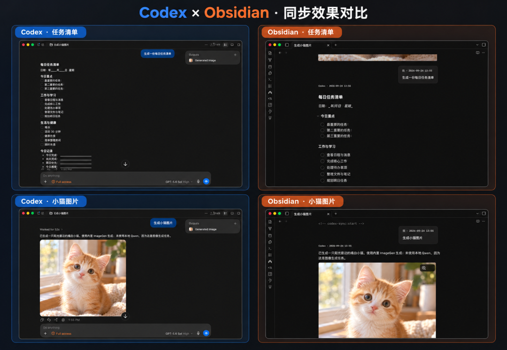

# Codex Daybook

[](https://obsidian.md/plugins?id=codex-daily-sync)
[](https://github.com/isink/Codex-Daybook/releases/latest)
[](LICENSE)


**把本机 AI 对话自动变成 Obsidian 笔记。** 每个 Codex Desktop 任务、每段 WorkBuddy 对话，都会成为一篇可搜索、可链接、能长期保存的 Markdown 笔记。



[快速开始](#快速开始) · [笔记长什么样](#笔记长什么样) · [WorkBuddy](#workbuddy-对话实验性) · [常见问题](#常见问题) · [English](README.en.md) · [隐私说明](PRIVACY.md) · [更新记录](CHANGELOG.md)

---

## 为什么用它

和 AI 聊出来的方案、排查结论、写好的段落，很快就会被新对话淹没。Codex Daybook 在后台把它们收进你的知识库：

- **自动归档**：一个任务一篇笔记，有新回复就增量更新，不用手动复制粘贴。
- **只留有用的**：保存你的提问、正式答复和正式计划；推理过程、工具调用、系统消息和没完成的轮次一律不写。
- **图片一起收**：对话里的本地图片复制进库内附件目录，按内容去重，直接显示在笔记里。
- **你的批注不会丢**：同步只改笔记里的同步区域，你在区域外写的文字和加的属性都会保留。
- **接上每日笔记**：可选按创建日把任务链接进 Dataview 每日轨迹，回顾一天做了什么。
- **完全本地**：插件自己不发任何网络请求、不上传对话、不收集遥测。

## 快速开始

**要求**：Obsidian 1.13.7 及以上（仅桌面端）、本机安装的 Codex Desktop。只有开启每日轨迹时才需要 [Dataview](https://obsidian.md/plugins?id=dataview)。

1. 在 Obsidian 打开 **设置 → 第三方插件 → 浏览**，搜索 **Codex Daybook**，安装并启用。
2. 打开插件设置，在 **基础设置** 里选好笔记目录和附件目录。Codex 程序位置默认自动检测。
3. 允许库外访问，点 **登录 Codex**，在浏览器完成 ChatGPT 登录，再点 **检查连接**。
4. 检查通过后点 **开始同步**。从这一刻起新建的 Codex 任务会自动变成笔记。

> **只会同步「开始同步」之后新建的任务。** 这是有意的设计，避免一次把几百个历史对话塞进库里。连接检查需要至少一个已有任务，没有的话先在 Codex 里随便完成一个。

<details>
<summary>手动安装 / Windows 说明</summary>

- **手动安装**：从 [最新 Release](https://github.com/isink/Codex-Daybook/releases/latest) 下载 `codex-daily-sync-<版本>.zip`，把里面的 `codex-daily-sync` 文件夹放进库的 `.obsidian/plugins/`，然后在第三方插件里启用。
- **Windows**：从 Microsoft Store 安装的 Codex Desktop 不允许其他程序启动它自带的 Codex，需要另装命令行版：`npm install -g @openai/codex`。它和桌面版读同一份对话数据。
- **自动检测失败**：可以在设置里一键扫描或手动选择 Codex 程序。只选你信任的程序，它会以你的权限运行。

</details>

## 笔记长什么样

每篇笔记带有属性（方便 Dataview 查询），正文是一问一答的标注块：

```markdown
---
title: 给周报加一个统计图
type: codex-conversation
created_at: 2026-11-06T10:46:53+08:00
daily: "[[Daily/2026-11-06]]"
---

<!-- codex-sync:start -->
> [!codex-question] 我 · 2026-11-06 10:46
> 周报脚本能不能顺便画一张本周提交数的柱状图？

> [!codex-answer] Codex · 2026-11-06 10:49

可以。我在 `report.py` 里加了 `plot_commits()`……
<!-- codex-sync:end -->

这里往下是你自己的批注，同步不会动它。
```

## 同步什么，不同步什么

| 会写进笔记 | 不会写进笔记 |
|---|---|
| 你的提问 | 推理过程 / 思考内容 |
| 正式答复、正式计划 | 工具调用和命令输出 |
| 对话中的本地图片（PNG / JPEG / GIF / WebP） | 系统消息、内部上下文 |
| 任务标题、创建时间等属性 | 进行中或失败的轮次、远程图片 |

- 每个任务固定自己的目录、时区和创建日，之后改设置不影响旧笔记。
- 没有变化的对话不会重写笔记。
- 删除或归档源对话 **不会** 删除本地笔记、图片和每日链接。

## WorkBuddy 对话（实验性）

在设置的 **WorkBuddy** 标签页点 **一键扫描 WorkBuddy 数据** 自动填写目录，再点 **检查本地数据**；通过后点 **开始 WorkBuddy 同步**。点击这些本地读取操作即表示授权对应的只读访问，不需要再打开独立权限开关；如果扫描不到，仍可手动填写绝对路径。

- 读取本机 `~/.workbuddy/projects`、WorkBuddy 环境变量指定目录或常见应用数据目录下的对话记录（也可以填其他绝对路径），笔记默认写入 `WorkBuddy Conversations/`。扫描仅检查这些限定位置，不遍历整块磁盘。
- 提问里的图片复制进 `Attachments/WorkBuddy/<笔记名>/`（可修改），直接显示在提问中。
- 不需要 WorkBuddy 账号令牌，不调用 WorkBuddy 云端接口。
- 与 Codex 同步互不影响，默认关闭。首次开启会导入已有的本地对话。
- 已在 macOS 版 WorkBuddy 5.6.2 和 5.7.7 验证。纯云端任务暂不支持。WorkBuddy 的本地格式没有公开承诺稳定，格式不兼容时只停止导入该对话，已有笔记保持不变。

## 隐私

- 登录走 Codex 官方的浏览器授权。插件 **不接触密码和登录令牌**。
- 插件本身不发 HTTP 请求、不上传对话、不收集遥测、不自动安装依赖。
- Codex 程序本身会按它的配置连接 OpenAI；你的库是否上传到云端取决于你自己的同步工具。
- 插件的 `data.json` 存有任务 ID 和笔记路径，属于个人数据，不要公开分享。

完整说明见 [PRIVACY.md](PRIVACY.md)。

## 常见问题

**能导入 ChatGPT 网页版的历史吗？**
不能。它只处理本机 Codex Desktop 的主任务，以及可选的本机 WorkBuddy 对话。

**为什么以前的任务没有同步？**
只同步「开始同步」之后新建的 Codex 任务。WorkBuddy 例外：首次开启会导入已有的本地对话。

**我在笔记里写的东西会被覆盖吗？**
不会。同步只更新笔记里由插件管理的区域，区域外的文字和你加的属性都会保留。

**界面支持中文吗？**
支持简体中文和 English，在设置的「语言」里切换，只影响界面文字。

## 兼容性

| 项目 | 状态 |
|---|---|
| Obsidian | 1.13.7+，仅桌面端 |
| macOS | 已验证 |
| Windows | 支持，实机验收进行中 |
| WorkBuddy | macOS 5.6.2、5.7.7 已验证 |

## 开发

```sh
npm ci
npm run package   # lint、测试、构建并做发布前隐私检查
```

问题和建议欢迎提 [Issue](https://github.com/isink/Codex-Daybook/issues)。

---

MIT 许可证。本项目不是 OpenAI、WorkBuddy 或 Obsidian 的官方插件。
